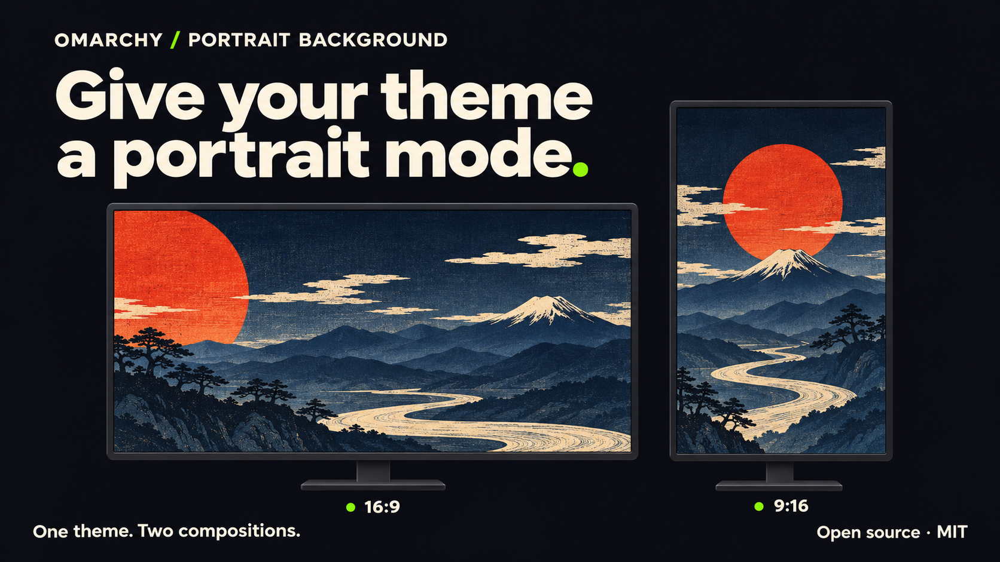

<p align="center">
  
</p>

<p align="center">
  <b>Give your theme a portrait mode.</b><br>
  Theme-provided portrait wallpapers, automatically matched to each monitor on Omarchy.
</p>

<p align="center">
  <a href="LICENSE"></a>
  <a href="https://github.com/marselnenaj/omarchy-portrait-background/releases"></a>
  
  <a href="https://github.com/marselnenaj/omarchy-portrait-background/actions/workflows/ci.yml"></a>
</p>

<p align="center">
  <a href="#quick-start">Quick start</a> ·
  <a href="#add-portrait-artwork-to-a-theme">For theme authors</a> ·
  <a href="#update">Update</a> ·
  <a href="#status-and-limits">Limits</a> ·
  <a href="docs/data-contract.md">Data contract</a> ·
  <a href="CHANGELOG.md">Changelog</a>
</p>

<p align="center"><sub>Illustrated preview, created with AI. The plugin displays artwork supplied by the theme; it does not generate or recompose images.</sub></p>

## Why Portrait Background

Turn a monitor upright and a landscape wallpaper loses most of its composition.
Portrait Background lets a theme carry a separate picture designed for that tall screen.
Apply the theme, and each portrait monitor gets the artwork that fits its shape.
Your landscape monitors keep the usual background.

It builds on Omarchy's own background renderer. Theme transitions, background cycling,
intro videos, double-click actions and the background CLI continue through the same renderer.
If the theme has no matching portrait artwork, the normal background fills the screen.

**The theme needs portrait artwork.** Installing this plugin alone does not add portrait
versions to existing themes. Bring your own PNG, JPEG or WebP; the included tool prepares
the small manifest that connects it to the theme.

## What each monitor shows

| Situation | Result |
| --- | --- |
| Landscape monitor | The normal theme background |
| Portrait or square monitor with matching theme artwork | The theme's composition for that shape |
| No matching artwork, missing file or failed validation | The normal background, cropped as usual |
| Video background | Omarchy's normal video background |
| An image selected outside the theme's `backgrounds/` | The image you selected |

Matching uses the monitor's logical aspect ratio, within 1.5%. Rotation and scale are
reflected in that size. A theme can supply up to six compositions, including 9:16,
10:16 and square artwork. Portrait artwork is shared by the theme's still backgrounds;
this release does not pair a different portrait image with every landscape image.

## Quick start

You need **Omarchy with its Quickshell background plugin**, Python 3, Git, Bash and GNU
coreutils. These tools normally ship with Omarchy. The installer checks the actual
`Background.qml` on your machine before writing the plugin. The release was checked
on **Omarchy 4.5.0-3**; other versions must pass the same compatibility checks.

Clone the release and inspect the installation plan:

```sh
git clone --branch v1.0.3 --depth 1 https://github.com/marselnenaj/omarchy-portrait-background.git ~/.local/share/omarchy-portrait-background
cd ~/.local/share/omarchy-portrait-background
./portrait-background status
./portrait-background install
```

Then install and enable it:

```sh
./portrait-background install --apply
./portrait-background enable --apply
./portrait-background status --live
```

The installer writes a user plugin at `~/.config/omarchy/plugins/bogen.portrait-background`.
Installing and enabling are separate steps. Every action plans by default; **`--apply`
is required to change anything**. Run the commands as your own user.

**Use this installer rather than `omarchy plugin add`.** The background renderer must
be derived from your installed Omarchy. The repository includes a runnable source
snapshot for marketplace review, but that snapshot is tied to the release host's
Omarchy version. The marketplace submission requests **Manual setup** for this reason.

## Add portrait artwork to a theme

Put a finished portrait picture in the theme's `displays/` folder, then run:

```sh
python3 tools/make-runtime-manifest.py ~/.config/omarchy/themes/my-theme displays/portrait-9x16.png
omarchy theme set my-theme
```

The image must already exist in that folder. Use a lowercase filename, PNG, JPEG or
WebP, between 320 and 16384 pixels per side, and at most 48 MiB. You can pass several
image paths to add more monitor shapes. The tool reads their dimensions and writes
their byte counts and SHA-256 hashes into `displays/portrait-runtime.json`.

A minimal theme layout looks like this:

```text
my-theme/
├── backgrounds/
│   └── landscape.webp
└── displays/
    ├── portrait-9x16.png
    └── portrait-runtime.json
```

The rest of the theme stays as it is. The manifest is data only; no code from a theme
runs. The plugin checks each composition's file, size, format, dimensions and hash,
and displays a verified cached copy. A failed check falls back to the usual wallpaper.

For a small synthetic example that writes only to `/tmp`:

```sh
python3 examples/make-example-theme.py /tmp/portrait-example
```

This demonstrates the files; it is not a complete installable Omarchy theme.
See the [data contract](docs/data-contract.md) for the full format.

## Update

Keep the checkout and switch to the release you want to install:

```sh
cd ~/.local/share/omarchy-portrait-background
git fetch --tags origin
git switch --detach v1.0.3
./portrait-background install
./portrait-background install --apply
./portrait-background status --live
```

Replace `v1.0.3` with the new release tag when updating. Before replacing files, the
installer backs up the previous version. Hand-edited plugin files require `--force`.

After an **Omarchy update**, run `status` again. If the stock background renderer changed,
`install --apply` derives a fresh copy when all patch anchors still match. If they do not,
the installer refuses the update. Use `disable --apply` to restore Omarchy's background
until a compatible plugin release is available.

Omarchy reloads plugin files automatically, but may retain QML it already imported.
`status --live` reports a version mismatch; run `omarchy restart shell` if it asks you to.
`omarchy plugin update` does not manage this generated installation.

## Disable, roll back or remove

```sh
./portrait-background disable --apply
./portrait-background rollback --apply
./portrait-background remove --apply
```

These are separate actions. **Disable** restores Omarchy's built-in background.
**Rollback** restores the most recent plugin backup, keeping a backup of the current
files. **Remove** backs up and removes the plugin, and requires it to be disabled first.

You can also remove it through Omarchy:

```sh
omarchy plugin remove bogen.portrait-background
```

That command disables the plugin and restores the built-in background before removal.
Backups made by this installer live in `~/.local/state/bogen/portrait-background/backups/`.
Removing the plugin leaves the source checkout, state and image cache available.

## Status and limits

The runtime has been observed on a real Omarchy desktop with one 4K landscape monitor
and one 4K monitor rotated 270°. The running plugin reports a normal landscape background
and the verified 9:16 composition on the portrait monitor. Installer, rollback, refusal
paths, matching logic and fixed file-processing scripts have automated coverage.
See [release validation](docs/release-validation.md) for the exact checks and limits.

- **Rotation changes, hotplug and rescaling during a live session are not qualified.**
- The lock screen is a separate plugin and continues to use the normal background.
- Video backgrounds and intro videos keep Omarchy's behavior; the portrait still follows the intro.
- The theme transition waits up to 1.5 seconds for portrait validation. A slower check
  can briefly show the normal background before the portrait artwork appears.
- Another installed clone of `omarchy.background` blocks enabling this plugin.
  Both plugins need control of the same background service.
- Plugins run inside the Omarchy shell with your user permissions. This plugin needs
  no root access and performs no network requests at runtime.

## Development

Python's standard library and Node's built-in test runner are enough:

```sh
python3 -m unittest discover -s tests -v
node --test tests/runtime.test.mjs
bash -n portrait-background
```

On the tested Omarchy host, refresh or verify the marketplace review snapshot with:

```sh
python3 tools/prepare-marketplace.py
python3 tools/prepare-marketplace.py --check
omarchy plugin validate .
```

The tests use temporary homes and stand-in Omarchy commands. They also execute the
runtime's fixed file-processing scripts against temporary themes. They do not change
your installed plugin or desktop. [Contributing](CONTRIBUTING.md) covers changes and bug reports.

## License

[MIT](LICENSE), by Marsel Nenaj and contributors. The derived background renderer retains
[Omarchy's MIT license](licenses/OMARCHY-MIT.txt). See [NOTICE](NOTICE) for provenance.
The illustrated header and marketplace preview are included as project artwork.
